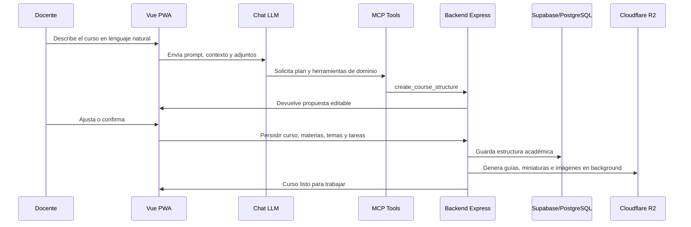

<div align="center">

<h1>Yasuy | Full Stack Developer</h1>

<p>
  Construyo productos web completos con arquitectura limpia, automatización e inteligencia artificial aplicada a flujos reales de negocio.
</p>

<p>
  
  
  
  
  
  
</p>

<table>
  <tr>
    <td align="center"><strong>Producto</strong><br>CourseV, plataforma educativa multi-tenant</td>
    <td align="center"><strong>Arquitectura</strong><br>Puertos, adaptadores, casos de uso y dominio modular</td>
    <td align="center"><strong>IA aplicada</strong><br>Cursos, guías, imágenes, cómics, video y RAG</td>
    <td align="center"><strong>Canales</strong><br>Web PWA, chat LLM, WhatsApp, sockets y notificaciones</td>
  </tr>
</table>

</div>

## Resumen ejecutivo

CourseV es el proyecto que resume mi enfoque full stack: una aplicación educativa que no se queda en CRUD, sino que integra frontend PWA, backend modular, IA generativa, MCP, WhatsApp, reportes, pagos, almacenamiento, tiempo real y multi-tenancy.

El objetivo del sistema es permitir que docentes e instituciones creen experiencias de aprendizaje completas. Desde lenguaje natural, un docente puede pedir un curso profesional; el backend estructura materias, temas, tareas, guías y recursos visuales; el frontend permite revisar, ajustar y confirmar el resultado antes de persistirlo.

## Perfil técnico

Soy desarrollador full stack orientado a construir sistemas reales, no solo interfaces aisladas. Trabajo de punta a punta: experiencia de usuario, contratos de dominio, APIs, persistencia, integraciones externas, IA, tiempo real, despliegue y automatización.

Mi enfoque está en diseñar productos que puedan crecer sin perder claridad: frontend desacoplado, backend modular, arquitectura hexagonal, puertos y adaptadores, patrones de confiabilidad, validación fuerte y procesos asíncronos para tareas costosas.

Trabajo especialmente bien donde el producto necesita unir varias capas: una interfaz cuidada, reglas de negocio consistentes, integraciones externas, datos confiables y automatización con modelos de IA.

## Qué construyo

| Línea de trabajo | Aplicación en CourseV |
| --- | --- |
| Producto full stack | Flujos completos para estudiantes, docentes, administradores e instituciones. |
| Arquitectura de dominio | Modelos, puertos, servicios, casos de uso, repositorios y adaptadores desacoplados. |
| IA productiva | Generación de cursos, guías, contenido visual, análisis de imágenes, RAG y refuerzo educativo. |
| Automatización educativa | Cursos completos desde lenguaje natural, materiales docentes convertidos en recursos profesionales. |
| Canales conversacionales | Chat LLM dentro de la app y WhatsApp conectado a MCP para consultas y reportes. |
| Infraestructura | Supabase/PostgreSQL, pgvector, Cloudflare R2, Wompi, FCM, email, Docker, Railway y Wrangler. |

## Proyecto destacado: CourseV

CourseV es una plataforma educativa full stack para crear, administrar y consumir cursos profesionales con apoyo de inteligencia artificial. El sistema combina cursos, materias, temas, tareas, entregas, calificaciones, progreso, certificados, videos, pagos, notificaciones, WhatsApp, RAG, generación de contenido y experiencias de aprendizaje con texto e imágenes.

La app está pensada para docentes, estudiantes e instituciones. Un docente puede crear contenido manualmente o describir en lenguaje natural el curso que necesita; el backend convierte esa intención en una estructura completa con materias, temas, tareas, guías, miniaturas y recursos de aprendizaje.

## Capacidades principales

| Área | Qué resuelve |
| --- | --- |
| Creación académica | Cursos, materias, temas, tareas, entregas, calificaciones, periodos, progreso y certificados. |
| Aprendizaje visual | Modo cómic, video/slideshow, escenas con imágenes generadas y explicación textual. |
| IA para docentes | Creación de cursos por prompt, ajustes conversacionales, guías Word/PDF y miniaturas educativas. |
| IA para estudiantes | Chat con contexto, refuerzo personalizado, análisis de materiales e itinerarios de aprendizaje. |
| MCP | Herramientas para consultar datos, crear estructuras, obtener entregas y disparar acciones controladas. |
| WhatsApp | Vinculación OTP, consultas administrativas, Excel, PDF, gráficas y respuestas formateadas. |
| Operación | Multi-tenant, roles, permisos, almacenamiento, pagos, sockets, notificaciones y despliegue. |

## Arquitectura general

```text
Vue 3 PWA + TypeScript
        |
        | Puertos de dominio + adapters HTTP + sockets
        v
Node.js / Express API
        |
        +-- Módulos de dominio: auth, course, subject, topic, task, grade, progress
        +-- IA: LLM, MCP, RAG, visión, aprendizaje con imágenes
        +-- Canales: Web, WhatsApp, Socket.io, notificaciones
        +-- Infraestructura: Supabase, pgvector, R2, Wompi, FCM, email, OpenRouter
        |
        v
Multi-tenant data layer + almacenamiento + servicios externos
```

## Arquitectura hexagonal

El sistema está construido separando dominio, aplicación e infraestructura para que las reglas importantes no dependan directamente de frameworks, proveedores o detalles externos.

| Capa | Frontend | Backend |
| --- | --- | --- |
| Dominio | `src/domain/models.ts`, `src/domain/ports.ts` | entidades, servicios de dominio, casos de uso |
| Aplicación | stores Pinia, router guards, composables, vistas por feature | orquestación de cursos, IA, progreso, entregas, pagos, WhatsApp |
| Adaptadores de entrada | Vue Router, UI views, formularios, sockets | Express routes, controllers, MCP HTTP/stdio, webhooks |
| Adaptadores de salida | `src/infrastructure/api/*Adapter.ts` | Supabase repositories, R2, OpenRouter, Wompi, FCM, email, WhatsApp |
| Infraestructura | Vite, PWA, Cloudflare/Wrangler | Docker, Railway, Socket.io, Supabase, pgvector, cache, queues |

Esta separación permite cambiar un proveedor de IA, almacenamiento, pagos o mensajería sin romper el núcleo del producto.

### Flujo de una creación de curso con IA



## Diseño de dominio

El frontend mantiene contratos explícitos en `src/domain/models.ts` y `src/domain/ports.ts`. Las vistas no deberían conocer detalles de transporte; consumen adaptadores en `src/infrastructure/api/*Adapter.ts`, stores y composables. Ese patrón facilita probar reglas, cambiar endpoints y mantener la UI desacoplada.

En backend, la estructura replica el mismo criterio: módulos con `entity`, `service`, `controller`, `routes` e `infrastructure`. Los casos de uso como creación/publicación de curso viven separados de Supabase, WhatsApp, pagos, R2 o modelos de IA.

## Frontend

El frontend está desarrollado como una PWA con Vue 3, TypeScript, Pinia y Vue Router. La estructura no mezcla directamente la UI con los detalles del backend: las pantallas consumen puertos y adaptadores HTTP, mientras los modelos de dominio mantienen contratos claros.

Puntos clave:

- Interfaz modular por features: auth, home, explore, course, learning, chat, video, profile, admin, ICFES, reinforcement y notifications.
- Adaptadores dedicados para cursos, usuarios, progreso, tareas, entregas, contenidos, pagos, WhatsApp, videos, materias y chat.
- Guards de navegación para controlar acceso por matrícula, curso activo, colaborador o rol.
- Sockets para eventos en tiempo real: cursos, progreso, materias, chat y video.
- UI de aprendizaje con cómic, video/slideshow, texto narrativo e imágenes generadas por IA.
- Chat LLM con adjuntos de imagen, contexto de tareas, progreso de estudiantes y generación de planes de curso.
- Flujo visual para confirmar un curso generado antes de persistirlo en backend.

El resultado es una app que puede crecer por dominios. Una vista de aprendizaje no necesita saber cómo se autentica Supabase, cómo se sube un archivo a R2 o qué proveedor de IA genera una imagen; consume capacidades expuestas por adaptadores.

Rutas relevantes del frontend:

- `src/ui/features/chat/ChatBotLLMView.vue`: chat asistido, adjuntos de imagen, modo curso, contexto de tareas y progreso.
- `src/ui/features/chat/components/CoursePlanCard.vue`: revisión visual del plan generado antes de crearlo.
- `src/ui/features/learning/*`: selección de curso, tema, tarea y modos de aprendizaje visual.
- `src/infrastructure/api/learningAdapter.ts`: generación de cómic, video/slideshow y regeneración de paneles.
- `src/infrastructure/api/whatsappAdapter.ts`: vinculación, verificación y estado de WhatsApp.
- `src/router/index.ts`: guards de autenticación, roles, matrícula, colaboradores y rutas de aprendizaje.

## Backend

El backend está desarrollado en Node.js con Express y una organización modular. Cada módulo mantiene su propio servicio, controlador, rutas, entidad e infraestructura cuando aplica.

Módulos principales:

- `auth`, `user`, `persona`, `rol`: autenticación, JWT, refresh tokens, RBAC y usuarios multi-tenant.
- `course`, `subject`, `topic`, `task`, `content-item`: estructura académica completa.
- `submission`, `grade`, `progress`, `period`: entregas, calificaciones, progreso, certificados y periodos.
- `ai`: LLM, MCP, RAG, contexto de aprendizaje, visión y generación de cursos.
- `learning`: cómics, videos educativos, imágenes por escena y fallback tipo slideshow.
- `whatsapp`: vinculación, verificación OTP, sesiones por tenant y consultas conversacionales.
- `notification`, `chat`, `video`, `payment`, `storage`: eventos, comunicación, streaming, Wompi y Cloudflare R2.

Piezas de arquitectura presentes en el backend:

- `src/config/container.js`: composition root con inyección de dependencias, repositorios, adaptadores y servicios.
- `src/shared/ports/*`: contratos para storage, pagos, notificaciones, email, cache y LLM.
- `src/shared/infrastructure/CircuitBreaker.js`: protección frente a servicios externos lentos o fallidos.
- `src/shared/middleware/IdempotencyMiddleware.js`: control de POST duplicados y excepciones para MCP/IA.
- `src/shared/database/CachedRepository.js`: cache-aside para lecturas recurrentes.
- `src/modules/ai/mcp.service.js`: herramientas MCP de dominio.
- `src/modules/learning/learning.service.js`: pipeline de cómic, video, imágenes y fallback.
- `src/modules/whatsapp/whatsapp.service.js`: canal conversacional con OTP, tenant, roles, MCP, Excel, PDF e imágenes.

## IA dentro de CourseV

La IA no está agregada como una pantalla decorativa; está integrada en el flujo del producto.

- Creación de cursos por lenguaje natural: el docente describe tema, nivel, duración y objetivos; el sistema propone un plan estructurado.
- Confirmación humana antes de escribir datos: el frontend muestra una tarjeta del plan y el docente puede ajustar, aceptar o rechazar.
- Persistencia automatizada: al confirmar, el backend crea curso, materias, temas y tareas.
- Generación en background: miniaturas educativas, guías Word/PDF para tareas y material explicativo.
- RAG educativo: el backend construye contexto desde documentos, tareas y materiales para responder con información relevante.
- Visión: el chat puede recibir imágenes y enviarlas al backend para análisis multimodal.
- Aprendizaje con texto e imágenes: CourseV convierte materiales de un tema/tarea en cómics, escenas visuales, narraciones y videos o slides.
- Refuerzo personalizado: genera preguntas y ejercicios usando historial del estudiante y filtros semánticos para evitar repetición conceptual.

### Pipeline de aprendizaje con texto e imágenes

1. El docente o estudiante selecciona curso, tema y tarea desde la PWA.
2. El backend construye contexto con datos académicos, contenido cargado y fragmentos RAG.
3. El modelo de texto genera un guion estructurado para cómic o video educativo.
4. El modelo de imagen convierte cada escena en recursos visuales.
5. Si el video no está disponible, la app entrega un slideshow narrado para que el aprendizaje no se bloquee.
6. Los recursos se muestran en una experiencia visual con texto, imagen, narración y progresión.

### Cursos completos desde lenguaje natural

El docente puede escribir una intención como "crea un curso avanzado de machine learning de 12 semanas con proyectos y evaluaciones". El sistema normaliza el nivel, la duración y la densidad de evidencias; propone competencias, resultados de aprendizaje, materias, temas, tareas y carga horaria; luego permite confirmar o ajustar el plan desde el chat antes de crear registros reales.

Este flujo evita que la IA escriba directamente sobre la base de datos sin revisión humana. La decisión final queda en la interfaz, mientras el backend mantiene las reglas de dominio.

## MCP

El MCP funciona como una capa de herramientas para que el modelo no solo responda texto, sino que pueda actuar sobre el sistema con permisos y contexto.

Herramientas implementadas:

- `query_database`: consulta controlada a la base de datos.
- `get_database_schema`: lectura del esquema disponible para razonar mejor.
- `create_course_structure`: creación de cursos completos con materias, temas y tareas.
- `get_user_info`: información de usuario.
- `get_course_info`: información de cursos.
- `get_task_submissions`: entregas asociadas a una tarea.
- `send_notification`: envío de notificaciones desde flujos asistidos.

En CourseV, MCP conecta lenguaje natural con acciones reales: consultar datos académicos, generar estructuras de curso, revisar entregas, apoyar decisiones administrativas y producir reportes.

### Labor del MCP dentro de la app

MCP actúa como frontera de seguridad y acción entre el LLM y el dominio. El modelo no necesita conocer tablas, rutas internas o servicios concretos; solicita una herramienta acotada y el backend decide si esa acción es válida según usuario, tenant, rol y caso de uso.

Ejemplos de trabajo real:

- Convertir una solicitud de curso en una estructura persistible con materias, temas y tareas.
- Consultar información académica sin exponer detalles innecesarios de infraestructura.
- Obtener entregas de estudiantes para apoyar calificación o retroalimentación.
- Disparar notificaciones desde flujos asistidos.
- Apoyar reportes administrativos que luego pueden enviarse por WhatsApp, Excel o PDF.

## MCP en WhatsApp

WhatsApp funciona como un canal conversacional para docentes y administradores. El backend vincula el número, valida OTP, resuelve el tenant correcto, revisa roles y enruta la solicitud hacia el servicio de IA/MCP.

Capacidades del canal:

- Consultas administrativas en lenguaje natural.
- Respuestas formateadas para WhatsApp.
- Generación de Excel y PDF desde solicitudes conversacionales.
- Reportes con gráficas enviados como imagen o documento.
- Manejo multi-tenant para usuarios vinculados a varias instituciones.
- Control de permisos para limitar consultas sensibles a docentes o administradores.

El flujo está diseñado para operar con contexto institucional. Si un número está asociado a más de una institución, el backend resuelve la sesión correcta, conserva contexto conversacional y evita mezclar datos entre tenants.

WhatsApp no es solo un bot de respuestas: funciona como interfaz de operación. Un administrador puede pedir reportes, descargar archivos, recibir gráficas como imagen y consultar información sin abrir el panel web, manteniendo permisos y trazabilidad.

## Imágenes y contenido generado por docentes

Los docentes pueden aportar contexto desde la app: texto, planificaciones, tareas, materiales e imágenes. El backend usa ese contexto para generar contenido profesional:

- Miniaturas realistas para cursos y materias.
- Cómics educativos basados en un tema o tarea.
- Escenas visuales para videos o slides.
- Guías de desarrollo en Word/PDF para orientar tareas sin resolverlas por el estudiante.
- Material de aprendizaje que combina explicación textual, narrativa e imagen.

Esto permite transformar insumos simples de un docente en cursos completos, visuales y coherentes.

Cuando el docente envía materiales, imágenes o descripciones, la IA los usa como contexto. Esa información puede alimentar miniaturas, escenas, cómics, guías, preguntas de refuerzo o cursos completos. La idea central es reducir trabajo operativo sin quitar criterio pedagógico al docente.

## Patrones de diseño y confiabilidad

El proyecto aplica patrones útiles para mantener el sistema extensible:

- Ports and Adapters para aislar dominio de proveedores externos.
- Repository para persistencia desacoplada.
- Dependency Injection mediante contenedor de servicios.
- Adapter para Supabase, R2, LLM, WhatsApp, Wompi, FCM, email y GitHub.
- Strategy para cambiar proveedores/modelos de IA.
- Decorator para cache de repositorios.
- Circuit Breaker para proteger llamadas a servicios externos.
- Outbox para eventos de dominio más confiables.
- Idempotency Key para evitar duplicados en operaciones POST.
- RBAC y middlewares de seguridad por ruta.
- Background jobs para generación pesada de documentos, imágenes y videos.
- WebSockets para estados y eventos en tiempo real.

| Patrón | Dónde se ve | Para qué sirve |
| --- | --- | --- |
| Ports and Adapters | `domain/ports`, `shared/ports`, `infrastructure/api`, repositorios Supabase | Separar reglas del proveedor externo. |
| Repository | `supabase.*.repository.js`, adapters HTTP del frontend | Evitar que UI o servicios dependan de consultas concretas. |
| Dependency Injection | `src/config/container.js` del backend | Componer servicios, repositorios y adaptadores sin acoplamiento directo. |
| Strategy | proveedores/modelos LLM, imagen, video, TTS, pagos y WhatsApp | Cambiar implementación sin reescribir casos de uso. |
| Decorator | repositorios cacheados y circuit breakers | Agregar cache/protección sin ensuciar el dominio. |
| Use Case | `CreateCourseUseCase`, publicación y matrícula | Encapsular decisiones de negocio con entradas y salidas claras. |
| Middleware | auth, tenant, rate limit, idempotencia, validación | Proteger rutas y estandarizar comportamiento transversal. |

## Stack

| Área | Tecnologías |
| --- | --- |
| Frontend | Vue 3, TypeScript, Vite, Pinia, Vue Router, PWA |
| UI/UX | CSS modular, componentes compartidos, animaciones, Lottie, responsive app views |
| Backend | Node.js, Express, Socket.io, Joi, JWT |
| IA | OpenRouter, LLM, RAG, embeddings, visión, generación de imágenes/video |
| MCP | JSON-RPC, herramientas de dominio, MCP HTTP/stdio |
| Datos | Supabase, PostgreSQL, pgvector, repositories, multi-tenant |
| Storage | Cloudflare R2, URLs firmadas, subida directa de archivos |
| Comunicación | WhatsApp Business/YCloud/Meta API, FCM, email, chat persistente |
| Pagos | Wompi, webhooks, transacciones |
| Calidad | TypeScript, contratos de dominio, validadores, pruebas Node, scripts de migración |
| Deploy | Docker, Railway, Wrangler, variables de entorno |

## Estructura del frontend

```text
src/
  domain/                 # Modelos y puertos del cliente
  infrastructure/api/     # Adaptadores HTTP por dominio
  stores/                 # Estado Pinia
  composables/            # Sockets, navegación, temas y utilidades reusables
  router/                 # Rutas, guards y carga lazy
  ui/features/            # Vistas por dominio de producto
  ui/shared/              # Componentes e iconos compartidos
```

## Ejecución local

```bash
npm install
npm run dev
```

Build de producción:

```bash
npm run build
```

Despliegue con Wrangler:

```bash
npm run deploy
```

## Lo que demuestra el proyecto

- Criterio para estructurar una app grande sin perder mantenibilidad.
- Capacidad full stack real: producto, UI, dominio, API, datos, IA e infraestructura.
- Uso práctico de arquitectura hexagonal en frontend y backend.
- Integración de IA con acciones reales, no solo respuestas de chat.
- Construcción de canales alternos como WhatsApp sobre el mismo dominio.
- Manejo de permisos, multi-tenant, almacenamiento, reportes, sockets y procesos asíncronos.
- Automatización de contenido educativo profesional desde lenguaje natural.

## Repositorios relacionados

- `coursev_web_frontend`: PWA web de CourseV.
- `mcp-backend-deploy`: API, MCP server, IA, RAG, WhatsApp, storage y módulos de dominio.

## Enfoque

Mi trabajo se centra en crear software que conecte experiencia de usuario, arquitectura y automatización. CourseV resume ese enfoque: una plataforma educativa completa donde frontend, backend, IA, MCP y canales externos trabajan como un solo sistema.
